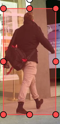
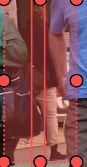

# Báo cáo cá nhân — TrieuHoangHieu-202603294

Tên file theo quy tắc `MSSV_HoTen.md`.

Đoạn video: MOT17-09, 150 frame (frame 1–150), nguồn MOTChallenge, giấy phép CC BY-NC-SA 3.0.

## 0. Thông tin học viên

- Họ tên: Triệu Hoàng Hiếu
- MSSV: 202603294
- Mã đề (A/B/C): B
- Email: 26ai.hieuth@vinuni.edu.vn
- Link repository: https://github.com/hieuwewe123/K5-L2B-TrieuHoangHieu-2A202603294-MOTTracking
- Giờ bắt đầu:
- Giờ kết thúc:

## 1. Xem trước đoạn video (CP0)

Ghi **trước khi vẽ**, mỗi người một dòng. Vì ghi chú CP0 ban đầu không còn đầy đủ, mốc cuối và cờ che dưới đây được đối chiếu từ export hiện tại; không xem đây là ghi chép chính xác đã lập trước khi vẽ.

| Mã | Frame xuất hiện | Frame cuối thấy được | Rẽ / dừng / đổi tốc độ ở frame | Bị che ở frame | Ghi chú |
|---|---|---|---|---|---|
| P1 | 0 | 149 (theo export) | Không ghi nhận | Không có cờ `occluded` | |
| P2 | 0 | 149 (theo export) | Không ghi nhận | 0–69 (theo cờ export) | |
| P3 | 0 | 119 (theo export) | Không ghi nhận | 90–119 (theo cờ export) | |
| P4 | 0 | 149 (theo export) | Không ghi nhận | 0–39, 110–119, 128–138, 149 (theo cờ export) | |
| P5 | 0 | 148 (theo export) | Không ghi nhận | 110–119, 139–148 (theo cờ export) | Khoảng frame 140–148 đi chậm hơn/đứng lại; outside ở 149. |

Khi xem lại CP0, Player step được đặt 10 frame mỗi lần tua. P1 không bị che theo quan sát hiện tại. Các khoảng `occluded`/`outside` trong bảng phản ánh trạng thái export, không khẳng định lại quan sát CP0 ban đầu.

## 2. Keyframe và thời gian (CP1, CP4)

Số keyframe lấy từ kết quả `src/check_submission.py`.

Đã đối chiếu ID MOT bạn cung cấp với track CVAT XML bằng cách so box tại các frame:

| Người | ID MOT | Track CVAT XML | Vai trò |
|---|---:|---:|---|
| P1 | 1 | 0 | Bài chính |
| P2 | 2 | 1 | Bài chính |
| P3 | 4 | 3 | Bài chính |
| P4 | 5 | 4 | Bài chính |
| P5 | 6 | 5 | Bài chính |
| Bonus B1 | 3 | 2 | Ghi mô tả người |
| Bonus B1 | 7 | 6 | Ghi mô tả người |

| Track CVAT | Keyframe | Frame keyframe | Frame có mặt | Keyframe / 100 frame |
|---:|---:|---|---:|---:|
| 0 | 16 | 0, 10, 20, 30, 40, 50, 60, 70, 80, 90, 100, 110, 120, 130, 140, 149 | 150 | 10.7 |
| 1 | 16 | 0, 10, 20, 30, 40, 50, 60, 70, 80, 90, 100, 110, 120, 130, 140, 149 | 150 | 10.7 |
| 2 | 16 | 0, 10, 20, 30, 40, 50, 60, 70, 80, 90, 100, 110, 120, 130, 140, 149 | 143 | 11.2 |
| 3 | 9 | 0, 10, 20, 30, 40, 50, 90, 100, 110 | 120 | 7.5 |
| 4 | 17 | 0, 10, 20, 30, 40, 50, 60, 70, 80, 90, 100, 110, 119, 128, 129, 138, 149 | 132 | 12.9 |
| 5 | 10 | 0, 10, 20, 30, 40, 50, 80, 110, 139, 140 | 130 | 7.7 |
| 6 | 11 | 50, 60, 70, 80, 90, 100, 110, 120, 130, 140, 149 | 100 | 11.0 |
| **Tổng** | **95** | | **925** | **10.3** |

Track có nhiều keyframe nhất là P4 / CVAT track 4 (17 keyframe); đa số keyframe được đặt theo nhịp 10 frame, không nhớ lý do riêng khiến P4 có nhiều hơn.

| Mã | Số keyframe | Keyframe ở frame | Số frame có mặt | Keyframe / 100 frame | Thời gian (phút) | Chỗ khó |
|---|---|---|---|---|---|---|
| P1 | 16 | 0, 10, 20, 30, 40, 50, 60, 70, 80, 90, 100, 110, 120, 130, 140, 149 | 150 | 10.7 | Không nhớ | MOT 1 / CVAT 0; kiểm tra cờ `occluded` |
| P2 | 16 | 0, 10, 20, 30, 40, 50, 60, 70, 80, 90, 100, 110, 120, 130, 140, 149 | 150 | 10.7 | Không nhớ | MOT 2 / CVAT 1 |
| P3 | 9 | 0, 10, 20, 30, 40, 50, 90, 100, 110 | 120 | 7.5 | Không nhớ | MOT 4 / CVAT 3 |
| P4 | 17 | 0, 10, 20, 30, 40, 50, 60, 70, 80, 90, 100, 110, 119, 128, 129, 138, 149 | 132 | 12.9 | Không nhớ | MOT 5 / CVAT 4 |
| P5 | 10 | 0, 10, 20, 30, 40, 50, 80, 110, 139, 140 | 130 | 7.7 | Không nhớ | MOT 6 / CVAT 5; kiểm tra đoạn che/outside |
| **Tổng P1–P5** | **68** | | **682** | **10.0** | | |

Keyframe / 100 frame của cả bài chính = 68 ÷ 682 × 100 = **10.0**. Cả 7 track gồm bonus = 95 ÷ 925 × 100 = **10.3**.

Bạn đặt keyframe nhiều nhất ở P4 (17 keyframe; CVAT track 4). Đa số keyframe cách nhau 10 frame; không nhớ lý do riêng khiến P4 có nhiều hơn.

## 3. Đoạn bị che (CP2)

Người CP2: Person 5 trong CVAT (P5, MOT ID 6 / CVAT track 5). Bạn xác nhận coach cho phép dùng người này thay P1. Theo export hiện tại, đoạn che là frame 110–119, outside 120–138, hiện lại ở 139; giữ `occluded` tới frame 148, sau đó bật `outside` ở frame 149 khi người biến mất.

| Mốc | Frame |
|---|---:|
| Bắt đầu bị che một phần (bật `occluded`) | 110 |
| Mất hẳn (bật `outside`) | 120 |
| Hiện lại (tắt `outside`) | 139 |
| Thấy rõ trở lại (tắt `occluded`) | Không tắt; giữ `occluded` tới frame 148, sau đó bật `outside` ở frame 149 vì người biến mất. |

- Thời gian khuất hẳn: 19 frame (120–138) = khoảng 0.63 giây.
- Quyết định ID: giữ cùng ID khi hiện lại ở frame 139.
- Đoạn khuất hẳn 19 frame, ngắn hơn 60 frame. Bạn đã xem lại và xác nhận cùng người khi hiện lại ở frame 139, nên giữ cùng ID; bổ sung căn cứ cụ thể về ngoại hình/hướng/tốc độ nếu cần.

Ảnh chụp màn hình:





## 4. Tự review ID (CP3)

Lượt 1 theo người (đi ngược từ frame 149 về 0 trên CVAT), lượt 2 theo cảnh (nhảy 10 frame). Ít nhất 3 dòng; không có lỗi thì ghi một dòng "đã kiểm hai lượt, không lỗi".

Loại lỗi dùng đúng một trong 7 mã: `id_switch`, `fragmentation`, `lost`, `merge`, `false_track`, `drift`, `flag`.

| Frame | Mã người | Loại lỗi | Mô tả một câu | Phát hiện ở lượt | Đã sửa? |
|---:|---|---|---|---|---|
| 139 | P4 / MOT 5 (CVAT 4) | `flag` | Cờ `outside` được bật trễ khoảng 1 frame; phát hiện ở lượt 1 và xác nhận lại ở lượt 2; đã sửa. | Lượt 1 và lượt 2 | Đã sửa |
| | | | | | |
| | | | | | |

Đã ghi nhận 1 lỗi; cần hoàn tất lượt review còn lại để xác định có lỗi nào khác không.

Tổng hợp số lỗi đã ghi nhận theo loại:

| `id_switch` | `fragmentation` | `lost` | `merge` | `false_track` | `drift` | `flag` |
|---:|---:|---:|---:|---:|---:|---:|
| 0 | 0 | 0 | 0 | 0 | 0 | 1 |

Không có lỗi mới chỉ được phát hiện ở lượt 2; lỗi frame 139 đã thấy ở lượt 1 và được xác nhận lại ở lượt 2.

## 5. File xuất và kết quả tự kiểm (CP4)

| Kiểm tra | Kết quả |
|---|---|
| Tên file MOT 1.1 | `TrieuHoangHieu_mot.zip` |
| Tên file CVAT for video 1.1 | `TrieuHoangHieu_cvat_video.zip` |
| Số track ID khác nhau trong `gt/gt.txt` (5 track chính + 2 bonus B1) | 7 |
| Frame `outside` không có dòng trong `gt/gt.txt` (đúng / sai) | Có; các đoạn vắng trong export tương ứng với cờ `outside`. Script tự kiểm đạt 0 lỗi, 0 cảnh báo. |
| Job đã completed trên CVAT máy cá nhân | Có |

Dán phần tóm tắt in ra từ `src/check_submission.py`:

```text
Số frame in theo CVAT (bắt đầu từ 0). Trong gt.txt, frame_id = frame CVAT + 1.

=== File MOT 1.1: TrieuHoangHieu_mot.zip ===
  Số track ID: 7   |   Tổng số box: 925
  [OK]        Đúng 7 track ID.

  Track | Frame có mặt | Số frame | Đoạn vắng (outside)
      1 |   0–149      |      150 | -
      2 |   0–149      |      150 | -
      3 |   0–149      |      143 | 43–49
      4 |   0–119      |      120 | -
      5 |   0–149      |      132 | 120–127, 139–148
      6 |   0–148      |      130 | 120–138
      7 |  50–149      |      100 | -

=== File CVAT for video 1.1: TrieuHoangHieu_cvat_video.zip ===
  Tổng: 95 keyframe / 925 frame có mặt = 10.3 keyframe / 100 frame
  [OK]        Đọc được 7 track từ annotations.xml.

=== Tóm tắt ===
  Lỗi: 0   |   Cảnh báo: 0
  Đạt. Dán phần tóm tắt này vào báo cáo mục 5.
```
```

## 6. Ba câu kết

1. Nếu được gán lại, bạn sẽ đặt keyframe khác ở đâu? Vì sao?

   Mình vẫn chú trọng xác định khung hình đầu tiên mà mỗi người xuất hiện để tạo track đúng từ đầu.

2. Có chỗ nào bạn không chắc "cùng ID hay ID mới"? Bạn đã quyết định và ghi chú thế nào?

   Khi không chắc, mình sẽ tạm dừng và hỏi ý kiến cấp trên/giáo viên trước khi tiếp tục.

3. Một lỗi ID trong job của bạn (nếu không còn sót, chọn lỗi đã sửa) có thể làm xe tự lái dự đoán sai chuyển động của người đó như thế nào? Lỗi đó ảnh hưởng MOTA hay IDF1 nhiều hơn?

   Chưa rõ / không có ý kiến.

## Bonus (nếu làm)

### B1 — Hai người đi sát

Hai track bonus B1 tự chọn theo đề bài: MOT ID 3 (CVAT track 2) và MOT ID 7 (CVAT track 6). Đã kiểm tra và không phát hiện ID switch. Cả hai người bước ra từ trong nhà; người 7 chỉ xuất hiện sau vài frame đầu.

### B2 — So cách đặt keyframe

| Cách đặt | Số keyframe | Frame trôi nhất | Ghi chú |
|---|---:|---:|---|
| Đều mỗi 30 frame | Không ghi lại | Không ghi lại | Mỗi người đi khoảng 2–3 bước (ghi nhớ). |
| Theo chỗ đổi hướng | Không ghi lại | Không ghi lại | Không lưu kết quả định lượng. |

Ghi chú hiện nhớ được: mỗi người đi khoảng 2–3 bước; số keyframe và frame trôi nhất không được lưu lại.

### B3 — So với tracker có sẵn

| Frame | Mã người | Tracker làm gì | Nhãn của bạn | Giải thích (đoán rồi sửa / ghép IoU / box score thấp / ngoại hình) |
|---:|---|---|---|---|
| — | — | — | — | Chưa làm hoặc không còn kết quả để báo cáo. |

## 7. Tài liệu tham khảo và công cụ AI đã dùng

Nguồn dữ liệu: MOT17, MOTChallenge (Milan et al., 2016). Hướng dẫn lớp: `docs/GUIDELINE.md`, `CHECKPOINTS.md`.

Đã dùng Copilot chat để hỏi cách thao tác CVAT và diễn giải kết quả script tự kiểm; bổ sung các công cụ AI khác nếu bạn có dùng.
